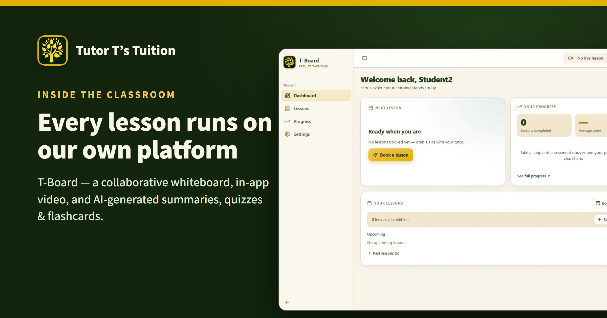
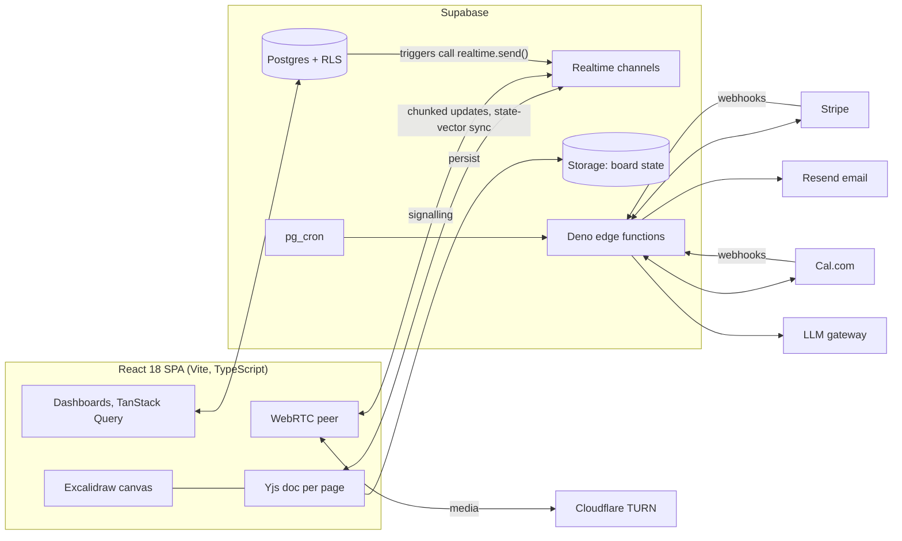

# T-Board — engineering case study

**A production tutoring platform, designed, built and operated by one developer.**
Live at [app.tutortstuition.com](https://app.tutortstuition.com) · product page [tutortstuition.com/t-board-for-tutors](https://www.tutortstuition.com/t-board-for-tutors) · Tomi Adepegba ([LinkedIn](https://www.linkedin.com/in/tomi-adepegba-77b8361a9))



T-Board replaced a Zoom + TutorBird + Calendly + manual-notes workflow for a UK tutoring practice. Every lesson, invoice and progress report in the business now runs through it, and since September 2026 independent tutors use it on a free trial. Real students, parents and tutors use it daily, so when something breaks, I am the one who finds out and fixes it.

> **Source code.** The application repository is private because it holds customer data in its operational notes. This repository describes the system and walks through problems I solved in it. Read access to a sanitised copy of the code is available to employers on request.

---

## What it does

| Area | What's in it |
|---|---|
| Classroom | A persistent collaborative whiteboard per student (Excalidraw + Yjs CRDTs), multi-page, with presence, cursors, lead/follow camera sync and "mirror my devices" |
| Video | Native one-to-one WebRTC with Cloudflare TURN, signalling over Supabase Realtime, device hand-over |
| Scheduling | Cal.com bookings via webhooks, in-app reschedule and cancel through the Cal.com v2 API, weekly standing slots booked automatically four weeks ahead |
| Money | Stripe Checkout for prepaid packs, pay-after invoices with daily reminders, bank-transfer reconciliation, Vault-encrypted bank details, tutor subscriptions with read-only mode on lapse |
| AI | Quizzes pitched at KS3 / GCSE / A-Level, flashcards with FSRS-4.5 spaced repetition, lesson plans and parent reports, via an LLM gateway with structured tool calling |
| Roles | Tutor, student, parent (read-only) and admin, enforced by Postgres row-level security, never by the frontend |

## Architecture



**Stack:** React 18, TypeScript, Vite, TanStack Query, Tailwind, shadcn/ui · Supabase (Postgres, RLS, Realtime, Storage, Auth, Deno edge functions, pg_cron, Vault) · Yjs, Excalidraw · WebRTC, Cloudflare TURN · Stripe, Cal.com, Resend · GitHub Actions CI with SQL regression tests · Cloudflare Workers hosting.

**Scale, from the repository (September 2026):**

| | |
|---|---|
| Commits | 2,100+ |
| Database migrations, each with its RLS and a written rollback | 181 |
| Tables / RLS policies in the live schema | 69 / 216 |
| Edge functions | 42 |
| Application TypeScript (excluding generated types and UI primitives) | ~50,000 lines |

---

## Case studies

Each of these was a real production problem. I include what broke, how I found it, and what now stops it happening again.

### 1. Scheduled jobs that "succeeded" while doing nothing

**Symptom.** Invoices, reminders and weekly bookings were occasionally missing, yet the scheduler reported every run as successful.
**Cause.** pg_cron called each edge function over HTTP with a 5-second default timeout. The functions took longer, the HTTP call gave up, and the scheduler recorded success because the request had been *sent*. No outcome was ever captured.
**Fix.** Every job now passes an explicit timeout and reads its secret from a secrets table instead of a literal in the schedule. Each function writes a row to a `cron_runs` ledger on start and on finish (counts, error). An admin health card shows the last run per job, so a silent failure is now a visible red row.

### 2. Webhooks that arrive in the wrong order, or twice

**Cal.com** occasionally delivered a cancellation before the booking it cancelled. The webhook now records a cancel for an unknown booking, and the later create checks for it and does not resurrect the lesson.
**Stripe** can replay events and can complete a Checkout session before the money has actually cleared (`payment_status` is not yet `paid` for asynchronous methods). The webhook now settles only paid sessions, handles `async_payment_succeeded`, deduplicates grants, and returns a 500 if marking an invoice paid fails, so Stripe retries instead of leaving a paid invoice open. A payment with no matching invoice raises an alert for the admin rather than disappearing.

### 3. A 2.4 MB whiteboard page that never reached the tablet

**Symptom.** A student's tablet showed an empty page while the laptop showed the full lesson.
**Cause.** Supabase Realtime silently drops messages over 1 MB. The initial sync sent the whole document in one message.
**Fix.** The sync handshake exchanges Yjs state vectors and sends only the missing difference. Any update over 96 KB is split into chunks and reassembled on the other side. A device whose download of the stored page failed is barred from uploading, so a partial copy can never overwrite the full one:

```ts
if (!this._loaded) {
  console.warn('[yjs-provider] persist skipped: stored state not loaded yet');
  return;
}
```

### 4. New pages that never saved

That same safety gate then caused the next bug. Storage answers a request for a missing object with HTTP 400, and the client library wraps it as an error with no status and the message `"{}"`. The gate read "new, empty page" as "download failed" and refused to save the page for the whole lesson. Strokes still synced live between devices, so nothing looked wrong until everyone left.
**Fix.** Read the status from the wrapped response, and treat 400/404 as "no stored copy". A page believed to be new is uploaded with `upsert: false`, so if Storage says it exists after all, the client goes back to loading it instead of overwriting it. Both error shapes were confirmed against the live bucket before shipping.

### 5. The final save that never ran

Drawing a stroke and switching page within three seconds lost the stroke. `destroy()` marked the provider destroyed and then called the save routine, whose first line returned when the provider was destroyed. The bug had been there since the original migration to Yjs. The fix passes an explicit `final` flag so the last flush always runs, and the invariant is now written into the project's rules for anyone touching that file.

### 6. Devices disagreeing about which page is open

With one person on two devices and a student following, each device kept re-sending its page and they pulled each other back. A time window ("whoever changed page in the last four seconds leads") reduced it but depended on timing. Page messages now carry a sequence number: a device ignores a page older than its own and adopts a newer one. Every decision is logged as a diagnostic event, so the next report can be traced message by message.

### 7. Cutting the biggest database cost

Realtime's `postgres_changes` feature works by polling the write-ahead log, and it was the largest consumer of database time. I replaced every such subscription with database triggers that call `realtime.send()` on private, per-user and per-board topics, consumed through one reference-counted client helper. The rule "no `postgres_changes` in the client" is now enforced in review.

---

## How I work

- **Specification first.** Every change starts as a written plan with assumptions, alternatives and a rollback path, then an atomic pull request.
- **AI-assisted, human-owned.** I build by directing AI coding agents (Claude Code) against written specifications and architectural invariants. I review every diff, run every migration and deploy, and own every incident.
- **Security in the schema.** Row-level security is written in the same migration that creates a table. Cross-user writes go through audited `SECURITY DEFINER` functions. Secrets for tutors' bank details and API keys are Vault-encrypted.
- **Evidence before fixes.** Production diagnostics (storage logs, client diagnostic events, run ledgers) come before any change, and live probes use real minted sessions rather than assumptions about grants.
- **Guard rails.** Typecheck gate before every commit, SQL regression tests for the money paths in CI, no deploys within three hours of a lesson.

---

© Tomi Adepegba. This document describes proprietary software; no licence to the application code is granted.
